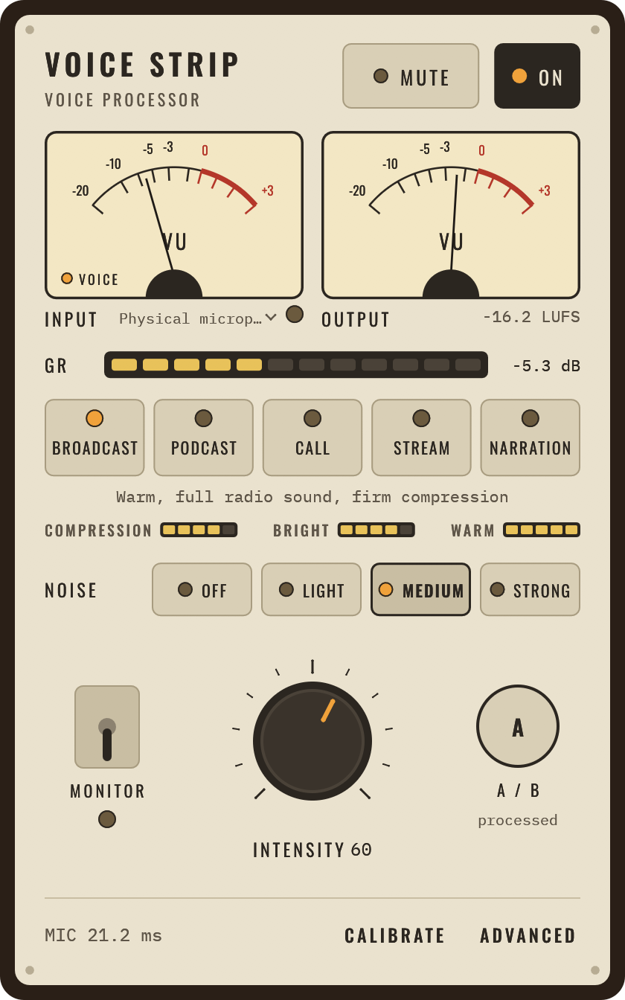
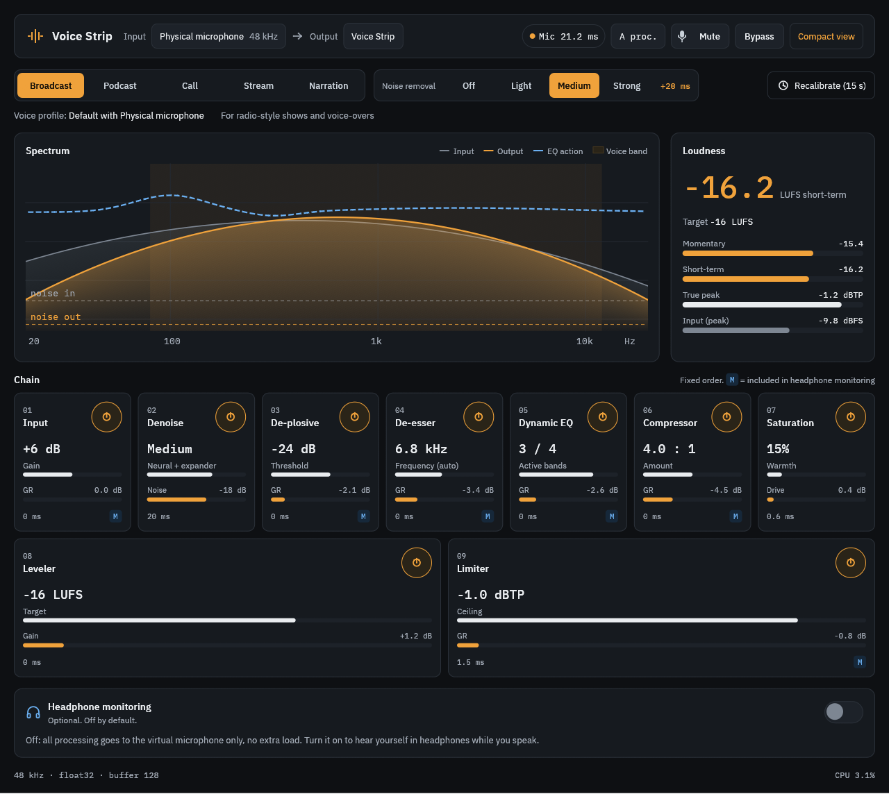

<div align="center">

# Voice Strip

**Your microphone, through a broadcast voice chain. Live, on Linux and macOS.**

  

 

</div>

Voice Strip makes a live microphone sound like it went through a well set up broadcast chain, with no audio knowledge needed. It reads your microphone, runs nine processing stages, and publishes the result as a **virtual microphone** that Zoom, Meet, OBS, a DAW or any other app can select.

> [!WARNING]
> Voice Strip is a research project for personal use, provided as is, without warranty of any kind. It was built largely with AI coding agents, steered and reviewed by a person. Use it at your own risk.

## Highlights

<table>
<tr>
<td width="50%" valign="top">

**One knob, broadcast sound.** Pick a preset (Broadcast, Podcast, Call, Stream or Narration) and set the Intensity. A 15 s calibration fits the chain to your microphone and room.

</td>
<td width="50%" valign="top">

**Built for live use.** 1.5 ms of processing delay. Neural noise removal adds 20 ms, and only when you turn it on.

</td>
</tr>
<tr>
<td valign="top">

**Works with every app.** `Voice Strip Microphone` on PipeWire, a `Voice Strip` Core Audio device on macOS. Select it like any other microphone.

</td>
<td valign="top">

**Stays on your computer.** No account, no cloud, no audio sent anywhere. The noise removal model downloads only after you agree, and only if its checksum matches.

</td>
</tr>
<tr>
<td valign="top">

**Hear yourself.** A low-latency headphone monitor, about 10 ms from microphone to ears on a MacBook.

</td>
<td valign="top">

**Out of the way.** Tray icon or menu bar item, and `voice-strip ctl` for scripts, key bindings and desktop bars, including an [Omarchy bar widget](extras/omarchy/io.github.paolomainardi.voicestrip/README.md).

</td>
</tr>
</table>

## The chain

Nine stages in a fixed order, tuned together by the preset and the Intensity knob:

1. **Input**: high-pass filter and proximity shelf.
2. **Noise removal**: the [DeepFilterNet3](https://github.com/Rikorose/DeepFilterNet) low-latency model plus a pause expander, in four levels.
3. **De-plosive**: tames pops on P and B.
4. **De-esser**: tames harsh S sounds.
5. **EQ**: static tone shaping plus dynamic bands that act only on excess.
6. **Compressor**: opto-style, for an even level.
7. **Saturation**: a touch of warmth.
8. **Leveler**: closed-loop, holds the loudness target.
9. **Limiter**: true-peak, so nothing clips.

Two views show it: a vintage faceplate for everyday use, and an advanced view with the spectrum, loudness and every stage. Both render on the GPU (Vulkan on Linux, Metal on macOS).

## Install on Linux from a release

Each [release](https://github.com/paolomainardi/voice-strip/releases) has a Linux x86_64 binary. It needs PipeWire, a Wayland or X11 desktop and a Vulkan driver, and runs on distributions with glibc 2.39 or later (Ubuntu 24.04, Debian 13, Fedora 40, Arch Linux and newer). On older ones, build from source.

```bash
curl -LO https://github.com/paolomainardi/voice-strip/releases/download/v0.1.0/voice-strip-v0.1.0-linux-x86_64.tar.gz
curl -LO https://github.com/paolomainardi/voice-strip/releases/download/v0.1.0/SHA256SUMS
sha256sum --check --ignore-missing SHA256SUMS
tar -xzf voice-strip-v0.1.0-linux-x86_64.tar.gz
./voice-strip-v0.1.0-linux-x86_64/voice-strip
```

Copy `voice-strip` anywhere on your `PATH` to use `voice-strip ctl` and `voice-strip --background`. macOS has no release binary: its virtual microphone driver must be signed on the machine that runs it, so build it from source as below.

## Build and run

You can also build Voice Strip from source, and on macOS you must: you sign its driver yourself (ad-hoc, which needs no Apple account). Install the build dependencies below, clone the repository, then follow the steps for your system. Noise removal needs a one-time download of the DeepFilterNet3 model (34.7 MB): the app asks before downloading it (see [Noise removal model](#noise-removal-model)).

### Build dependencies

Every system needs:

- **Rust**, stable 1.88 or later. [rustup](https://rustup.rs) is the simplest way to get a recent one; distribution packages are often older.
- **[just](https://github.com/casey/just)** 1.27 or later, which runs the recipes. Where the packaged one is older, use `cargo install just`.
- **curl**, which downloads the noise removal model when you agree to it.

Linux also needs a C toolchain, `pkg-config`, `clang` with libclang (to generate the PipeWire bindings) and the PipeWire development files. To run, it needs a PipeWire session, a Wayland or X11 desktop and a Vulkan driver for your GPU (Mesa's `radeon` or `intel` Vulkan driver, or NVIDIA's).

| System | Packages |
|---|---|
| Arch Linux | `pacman -S rust clang pkgconf pipewire just curl` plus `vulkan-radeon`, `vulkan-intel` or `nvidia-utils` |
| Debian, Ubuntu | `apt install build-essential pkg-config clang libclang-dev libpipewire-0.3-dev curl mesa-vulkan-drivers`, Rust from rustup, then `cargo install just` (Ubuntu 24.04 packages just 1.21) |
| Fedora | `dnf install gcc clang clang-devel pkgconf pipewire-devel just curl mesa-vulkan-drivers`, Rust from rustup |
| macOS 13 or later | `xcode-select --install` (C toolchain, `curl`, `codesign`), then `brew install rustup just` and `rustup default stable` |

The Debian, Ubuntu and Fedora lists are checked by building in clean Ubuntu 24.04 and Fedora 42 containers.

### Linux

```bash
just start                        # build, then run in the background on the default microphone
```

Pick the microphone and headphones in the app. To start on a given microphone instead, list the devices with `just devices` and pass one: `just start --input <node name>`. `just status`, `just logs` and `just stop` manage the running app.

Select **Voice Strip Microphone** as the microphone in your call or recording app.

### macOS

The virtual microphone is a Core Audio driver that `coreaudiod` loads from `/Library/Audio/Plug-Ins/HAL`. Build and install it once, and again after it changes, then start the app from Terminal:

```bash
just macos-driver             # build target/VoiceStrip.driver (ad-hoc signed)
just macos-driver-install     # install it and restart coreaudiod (asks for sudo; audio stops for a moment)
just start                    # build, then run in the background on the default microphone
```

As on Linux, pick devices in the app, or start on one with `just start --input <UID>` (see `just devices`).

Select **Voice Strip** as the microphone in your call or recording app.

- **Microphone permission.** macOS asks once, for the app that starts Voice Strip: start it from Terminal. A process started over SSH is never granted the microphone and records silence.
- **Uninstall.** `just macos-driver-install --uninstall`.
- **Signed builds.** `VOICE_STRIP_SIGN_IDENTITY` signs the driver with your identity instead (for example a Developer ID), and `VOICE_STRIP_TEAM` makes the installer accept only that team's signature. See `scripts/macos-driver.sh` for signing over SSH.

## Using it

- **Microphone and headphones.** Pick them in the app, or start with `--input` and `--headphones` (see `just devices`).
- **Presets and noise removal.** A preset sets the tone and loudness target; noise removal adds about 20 ms of delay, so it is off in the Broadcast, Podcast and Narration presets and on in Call and Stream.
- **Headphone monitor.** The headphones get a lighter chain than the virtual microphone, without noise removal, saturation or leveler, to keep the delay low. Bluetooth headphones add 150 ms or more of their own: use wired ones to monitor.
- **Background.** Closing the window keeps the app running: processing, the virtual microphone, the tray or menu bar item and remote control go on. Show window brings it back; Quit ends it. `voice-strip --background` starts without the window.
- **Without audio.** `just run --backend sim` shows the UI with a simulated signal.

### Remote control

The running app listens on a Unix socket private to the user (`$XDG_RUNTIME_DIR/voice-strip/ctl.sock` on Linux, `$TMPDIR/voice-strip/ctl.sock` on macOS). `voice-strip ctl` sends one command and prints the state as JSON:

```bash
voice-strip ctl status                 # state as JSON, with the preset list
voice-strip ctl watch                  # JSON lines on every change, with live meters
voice-strip ctl on | off | toggle      # processing
voice-strip ctl mute toggle            # mute: on off toggle
voice-strip ctl preset call            # broadcast podcast call stream narration
voice-strip ctl noise strong           # off light medium strong (needs the model)
voice-strip ctl model download         # download the noise removal model
voice-strip ctl intensity 70           # 0 to 100
voice-strip ctl phones toggle          # headphone monitor: on off toggle
voice-strip ctl show                   # open the window (starts the app)
voice-strip ctl start                  # start the app in the background, without its window
voice-strip ctl quit
```

The exit status is 0 on success, 1 when the app is not running or refuses the command, and 2 on a usage error.

## Latency

Processing delay from the microphone to the virtual microphone:

| | Noise removal off | Noise removal on |
|---|---|---|
| Linux, PipeWire quantum 480 | 1.5 ms | 21.5 ms |
| Linux, quantum 256 (PipeWire's power-of-two default) | 1.5 ms | 29.5 ms |
| macOS, 32-sample callbacks | 1.5 ms | 23.5 ms |

On macOS, reaching the `Voice Strip` device adds about 3.5 ms (resampler and transport margin). The headphone monitor measures about 10 ms from microphone to speakers on a MacBook. On Linux, `default.clock.power-of-two-quantum = false` in the PipeWire configuration keeps the 480 quantum Voice Strip asks for. Details: [docs/denoise.md](docs/denoise.md).

## Noise removal model

Noise removal uses the low-latency variant of [DeepFilterNet3](https://github.com/Rikorose/DeepFilterNet), a real-time speech enhancement network by Hendrik Schröter and colleagues ([paper](https://arxiv.org/abs/2305.08227)). The model is not part of the repository or the binary. The app finds it in this order:

1. `VOICE_STRIP_MODEL`: a model file you supply, used as is.
2. The cached copy in `~/.cache/voice-strip/` (Linux, or `$XDG_CACHE_HOME`) or `~/Library/Caches/voice-strip/` (macOS).

Nothing is downloaded without your consent. When you pick a noise removal level, or a preset that uses it, and there is no model, the app shows what it would download (size, source, licence, folder) and waits for **Download**. It then fetches the model from the [DeepFilterNet](https://github.com/Rikorose/DeepFilterNet) repository at tag v0.5.6, keeps it only if its SHA-256 matches, and turns the chosen level on. The model runs locally: no audio leaves the computer.

`voice-strip ctl model download` or `just fetch-model` downloads it without the dialog, for example in a script or before going offline. Until then, `voice-strip ctl noise` refuses levels other than `off`.

## Development

```bash
just hooks          # pre-commit hook: format check, clippy -D warnings, tests
just check          # the same by hand
just                # every recipe, grouped
```

Contributor and agent rules (realtime constraints, latency budget, commit conventions): [AGENTS.md](AGENTS.md). Specification: [docs/HANDOFF.md](docs/HANDOFF.md).

Measurements that need extra material, an idle machine or real devices are separate recipes: `just fetch-testdata` (LibriSpeech, CC BY 4.0), `just test-speech`, `just test-denoise`, `just test-timing`, `just test-pipewire` on Linux, and `just test-macos-driver` and `just test-macos-backend` on macOS (run from Terminal). Reports: [docs/loudness.md](docs/loudness.md), [docs/denoise.md](docs/denoise.md).

| Crate | Role |
|---|---|
| `crates/dsp` | Processing chain, no I/O |
| `crates/denoise-neural` | DeepFilterNet3 worker behind `dsp::FrameDenoiser`, model download |
| `crates/engine` | Realtime engine, lock-free queues, chain swap |
| `crates/vdev-linux` | PipeWire backend and virtual microphone |
| `crates/vdev-macos-driver` | macOS virtual microphone: Core Audio driver loaded by `coreaudiod` |
| `crates/vdev-macos` | macOS backend: capture, resampling, the driver's shared ring, headphone monitor |
| `crates/app-core` | Presets, tuning, calibration, controller, remote control |
| `crates/ui-kit` | Toolkit-neutral widgets and views |
| `crates/app` | Desktop app: egui on the GPU (wgpu), tray icon or menu bar item |

## Contribute

Contributions are welcome. Voice Strip is a personal research project, so agree on a change before writing it:

- **Issues first.** Report bugs and propose ideas in [issues](https://github.com/paolomainardi/voice-strip/issues). For a code change, open an issue and agree on the approach before the pull request.
- **Pull requests** must pass `just check` (run `just hooks` once to check before every commit), use [Conventional Commits](https://www.conventionalcommits.org/en/v1.0.0/), and follow the realtime rules and latency budget in [AGENTS.md](AGENTS.md). A behaviour change comes with a measurable test.
- **AI-assisted contributions** are welcome when a person has read, run and reviewed every change.
- **Merging.** Pull requests are squash-merged once the checks pass on Linux and macOS.

Unless you state otherwise, any contribution you submit is licensed as below (MIT OR Apache-2.0), without additional terms or conditions.

## Licence

Voice Strip is licensed under either of the [MIT licence](LICENSE-MIT) or the [Apache License 2.0](LICENSE-APACHE), at your option. Both licences provide the software as is, without warranty of any kind. Fonts, the DeepFilterNet model and test material come under their own licences: see [THIRD-PARTY.md](THIRD-PARTY.md).
